# FlipSay FAP

A mini SDR-style spectrum analyzer and Sub-GHz auto decoder for the Flipper Zero. It works with the internal CC1101, an external CC1101 and an external NRF24L01+.

This repository used to hold the browser-based version of FlipSay. That version is retired, and its downloads are still available as [Public Beta 1 and Public Beta 2](https://github.com/itsc0c0/flipsay/releases) on the Releases page (the old source stays in the git history, tag `web-legacy`).

> **Status: early release (0.2.1).** Built and checked against Momentum firmware `dev` (SDK `d3f89dfe`, API 87.1). Hardware testing is ongoing, so expect rough edges. If something crashes or misbehaves, open an issue and attach `trace.log` (see [Troubleshooting](docs/TROUBLESHOOTING.md)).

## Contents

- [Features](#features)
- [About FlipSay (in-app guide)](#about-flipsay-in-app-guide)
- [Wi-Fi module](#wi-fi-module-marauder)
- [SDR Mode and GQRX](#sdr-mode-and-gqrx)
- [What it is not](#what-it-is-not)
- [Requirements and install](#requirements-and-install)
- [How to use](#how-to-use)
- [Options reference](#options-reference)
- [Files the app creates](#files-the-app-creates)
- [Build from source](#build-from-source)
- [Credits and license](#credits-and-license)

## Features

### Views
Press **Back** to cycle through the views, or pick one under *Options > Display > View*.

#### Combo (default)
Spectrum on top, waterfall below, on one screen. The top bar shows the radio, center frequency, view, sweeps per second, span and state. The strongest peak is marked with a triangle and the cursor follows it, with its frequency and level shown at the bottom.

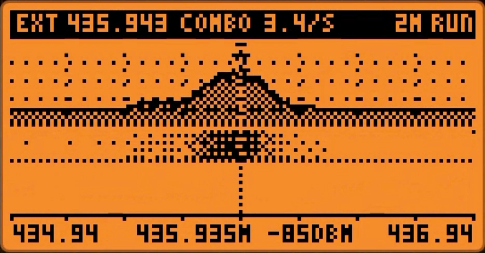

#### Spectrum
Full-height trace with a dBm scale, peak markers, a noise-floor line, a dotted peak-hold line and a cursor. Four fill styles: hatch, solid, line and gradient.

#### Waterfall
Scrolling history of the sweep as dithered grayscale, so signals that come and go leave a visible trail. Four palettes: dither, inverted, contour and threshold.

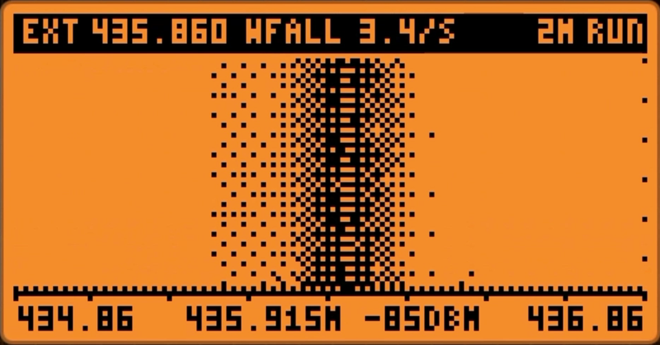

#### Persistence
Phosphor-style afterglow: frequently visited levels glow brighter and fade over time, which makes drifting or bursty signals easy to spot.

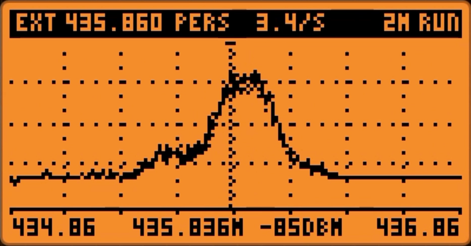

#### Pulse Scope
Shows the raw pulse timing of the last burst on a locked frequency (CC1101). It reports the pulse count, total time, shortest pulse, estimated baud rate and a guess at the coding (for example 1:3 PWM or 1:2 Manchester). On the NRF24 it shows carrier activity instead.

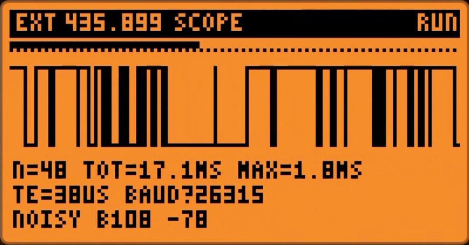

#### S-Meter
An analog-style gauge on a locked frequency, with a peak marker, a large dBm readout and a history strip along the bottom. Tune with Left / Right and change the step with Up / Down.

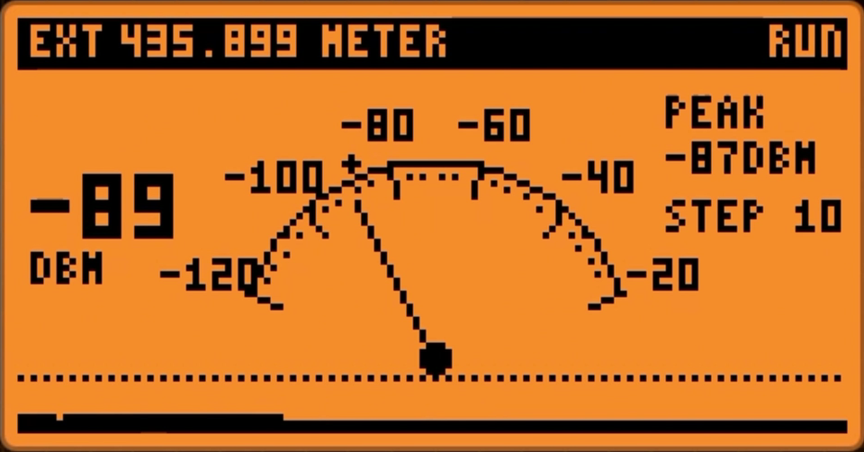

#### Signals
The strongest peaks ranked by level, with frequency, a level bar and a band label (for example "433 ISM" or "WIFI 6"). It also shows the noise floor, SNR, occupied bandwidth, hit count and duty cycle.

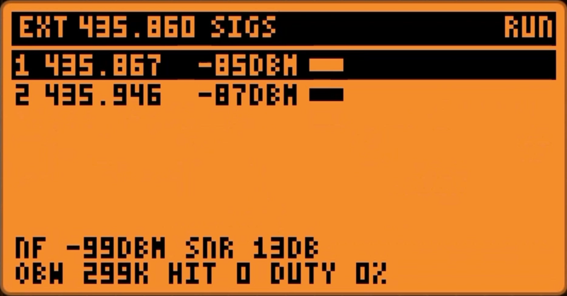

#### Channels
Occupancy bars. On the CC1101 the current band is split into 16, 32 or 64 segments. On the NRF24 there are pages for Wi-Fi, Zigbee and BLE channels.

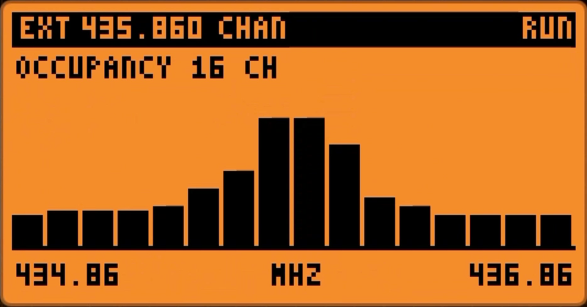

### Radios
- **Internal CC1101**, **external CC1101** (a generic module on the GPIO header) and **NRF24L01+**.
- *Auto* source detects what is attached and falls back to the internal radio.
- The CC1101 covers the Flipper's 281-962 MHz receive range. The NRF24 covers 2.400-2.527 GHz.
- Selectable CS pin (4 or 7) for the CC1101 and the NRF24, so both can be wired at the same time. See [wiring](docs/WIRING.md).

### Zoom and band scrolling
Zoom from a full band down to a **50 kHz** span (4 MHz on the NRF24). Zooming centers on the cursor, so a few presses of Up close in on a peak. Scroll across the whole band with Left / Right; holding the key speeds up automatically. Hold OK to jump to the next band preset (315, 318, 345, 390, 433.92, 868.35 and 915 MHz and wider windows; Wi-Fi, BLE and Zigbee windows on the NRF24).

The two screenshots below are the same signal at a 4 MHz and a 500 kHz span.

<p>
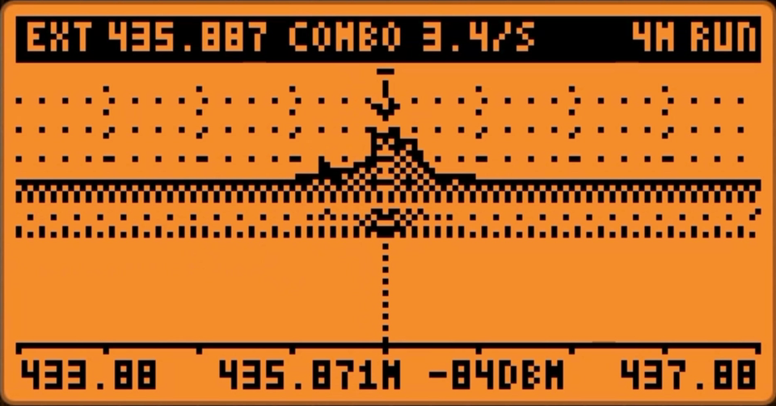
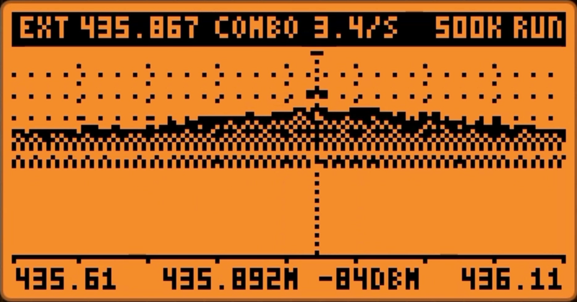
</p>

### Display tuning
Trace style, wave size (normal, big, huge), scale, overlays, grid, waterfall palette and rate, averaging, peak hold and cursor behavior are all adjustable under *Options > Display*.

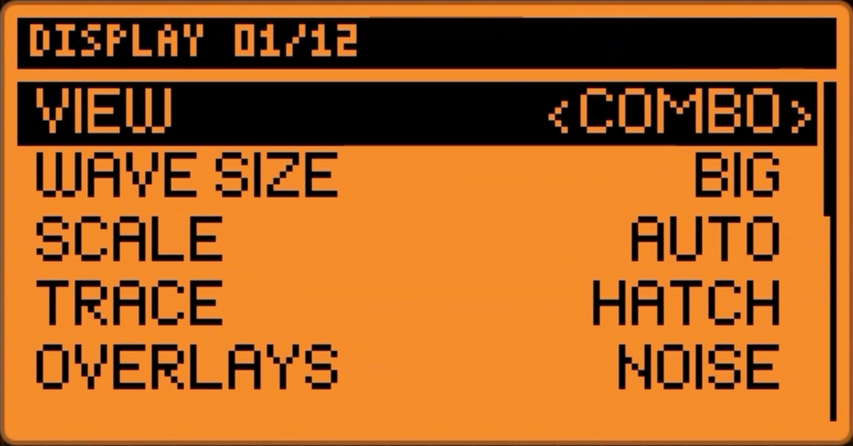

### Gain control
The CC1101's receiver gain stages can be set manually: LNA gain, mixer gain and IF target level, with a one-step reset to automatic. A manual RSSI offset corrects the dBm readout.

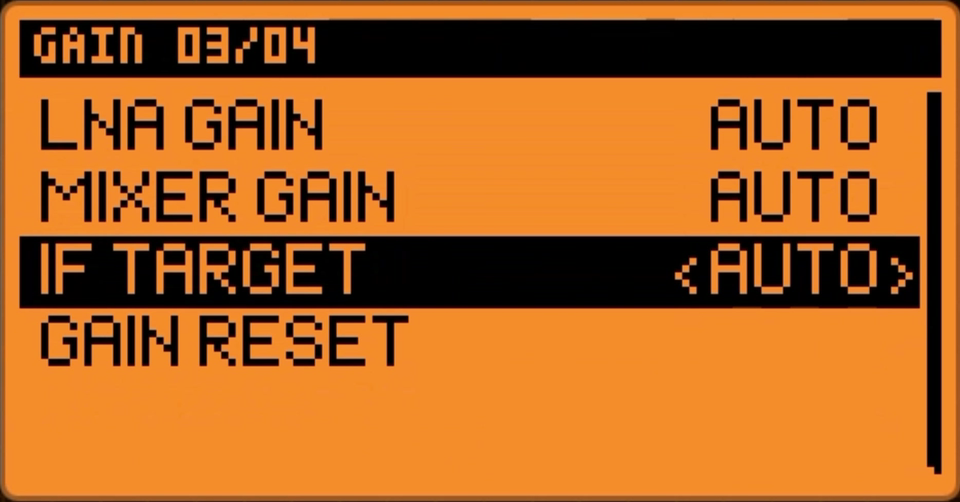

### Auto Decode
- Watches the common remote frequencies (300, 303.875, 304.25, 307.8, 315, 318, 390, 418, 433.075, 433.42, 433.92, 434.42, 434.775, 438.9, 868.35, 915, 925 MHz) plus the strongest peak from the spectrum.
- When a signal is strong enough it listens with several modulation presets (AM650, AM270, FM476, FM238) and decodes it with the **Sub-GHz protocol library from the Flipper firmware**. No protocol decoders were written for this project.
- Only remote-style protocols are enabled (static and rolling-code garage and gate remotes). Weather stations, tire-pressure sensors and other sensors are left out, and repeats of the same code are dropped.
- Decoded keys are saved as normal Sub-GHz `.sub` files in `/ext/subghz/FlipSay/`, not raw captures.
- An iPhone-style notification banner slides down from the top with an icon, the protocol name and the key, and disappears after 5 seconds.
- A saved-decodes manager lets you browse, inspect and delete the files.

### Parallel Gather (PG)
Uses the internal and external radio together. Because it runs two radios at once, enabling it takes four full-screen warnings, each confirmed by holding OK, and it is **off every time the app starts**.

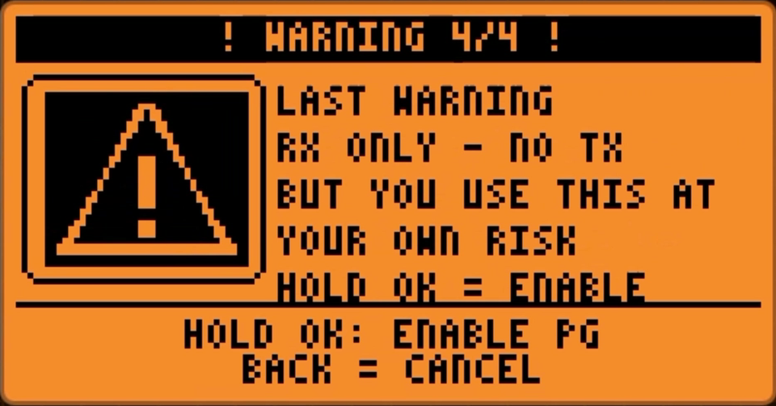

- **Merged:** both CC1101s sweep the same band and the display shows the better of the two readings (or the average). Per-radio level offsets compensate for antenna differences.
- **Multi Use:** several windows on one screen, each showing a source you pick. See below.

#### Multi Use windows
You choose the layout and what every window shows (*Options > Multi Use*):

| Layout | Windows |
|---|---|
| Left / Right | two side by side |
| Top / Bottom | two stacked |
| 2 Top + 1 | two on top, one wide window at the bottom |
| 1 Top + 2 | one wide window on top, two at the bottom |
| 4 Grid | four windows, one in each corner |

Every window can show one of: **EXT CC1101** spectrum, **INT CC1101** spectrum, **NRF24 spectrum**, **NRF24 packets**, **Wi-Fi module** or **Off**. The 4-window grid can therefore show EXT CC, INT CC, NRF24 and the Wi-Fi module at the same time. Only the radios that a visible window needs are swept, so the other ones stay idle. A window whose hardware is missing says "not found" instead of stopping the others.

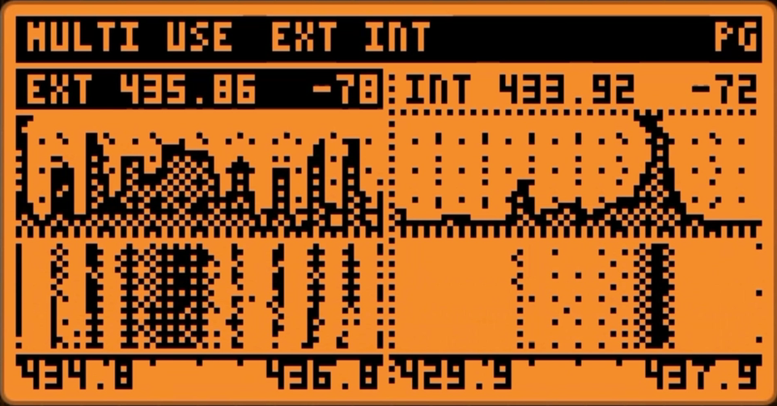

Each window's band is chosen on the Multi Use options page.

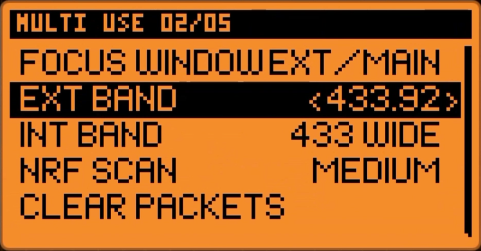

### Wi-Fi module (Marauder)
Multi Use can show the **official Flipper Zero Wi-Fi Devboard** running **ESP32 Marauder** firmware. FlipSay only listens (passive scan and sniff commands) and shows what comes back in four view modes: AP list, channel occupancy, packet rate graph and raw log. If the board does not answer, or answers but is not running Marauder, the window says so and tells you to update the firmware. Details: [docs/WIFI_MODULE.md](docs/WIFI_MODULE.md).

### SDR Mode and GQRX
*Options > SDR Mode* turns the Flipper into a spectrum source for [GQRX](https://gqrx.dk) (Linux/macOS) or [SDR++](https://github.com/AlexandreRouma/SDRPlusPlus) (Windows), or any rtl_tcp client, over USB. The screen goes black and shows "Waiting for USB to connect", then "Connecting" and "Connected" while a school bus drives back and forth along the bottom. A small PC script, `tools/flipsay_sdr_bridge.py`, does the rest. This is a **spectrum / waterfall link, not a real SDR**: there is no IQ and no audio. Details and setup: [docs/SDR_MODE.md](docs/SDR_MODE.md). Step-by-step for Windows: [Connect FlipSay to SDR++](docs/SDR_PLUSPLUS.md).

## About FlipSay (in-app guide)
*Options > About FlipSay* opens an illustrated guide, and it appears automatically the first time the app starts. It has 14 pages: the D-pad and Back key with the pressed key highlighted, one page for each feature group, and a credits page with the author (**itsc0c0**) and the GitHub link. The intro splash also shows "BY ITSC0C0". Replay the animated intro with *Options > System > Replay Intro*.

### Analysis and tools
- Noise-floor estimate, SNR, occupied bandwidth, automatic peak detection and band labels.
- Squelch trigger with LED and vibration alerts, and an action on trigger: log an event, save a screenshot or capture a raw `.sub` file.
- Marker B with a frequency and level delta readout.
- Raw `.sub` capture gated by signal strength (CC1101).
- CSV logging of every sweep, BMP screenshots, bookmarks.

### Under the hood
- A real boot loading bar that shows the actual startup steps (see [How to use](#how-to-use)).
- Lite Mode, a live memory and stack readout, and low-memory guards that show a message instead of crashing.
## What it is not

- It is **not a true SDR**. The CC1101 gives signal strength (RSSI) and pulse timings, not IQ samples. The spectrum is built by stepping the frequency and reading RSSI, at roughly 2-10 sweeps per second depending on speed and resolution.
- The NRF24 only reports carrier detect, so its levels are shown as activity percent.
- **Receive only.** There is no transmit function.
- Auto Decode uses one radio at a time. It cannot decode two frequencies simultaneously.
- **SDR Mode** gives GQRX a spectrum and waterfall only. The IQ stream is synthesized from the sweep, so GQRX cannot demodulate it and there is no audio.
- The Wi-Fi window is passive and needs Marauder firmware on the devboard.

## Requirements and install

- Flipper Zero running [Momentum firmware](https://momentum-fw.dev) (dev channel recommended).
- Optional: an external CC1101 module and/or an NRF24L01+ module (see [wiring](docs/WIRING.md)).

Install:
1. Download `flipsay.fap` from the [latest release](https://github.com/itsc0c0/flipsay/releases).
2. Copy it to `SD Card/apps/Sub-GHz/` with qFlipper or an SD card reader.
3. Open **Apps > Sub-GHz > FlipSay FAP**.

For rolling-code protocols to decode fully, keep the standard Sub-GHz asset files on the SD card (`/subghz/assets/`: KeeLoq manufacturer keys, Nice FloR-S, Alutech and Came Atomo tables).

## How to use

### 1. First launch
1. Start the app. A loading bar shows each step (settings, buffers, radio drivers, probing the CC1101 and NRF24, first sweep). The intro ends when the radio is ready. Press any key to skip the animation.

   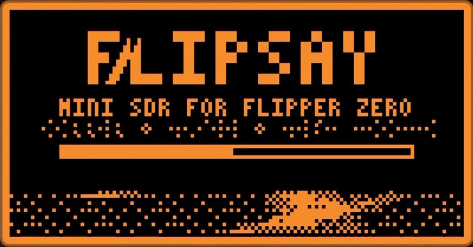

2. With **Auto** source it picks the external CC1101 if it finds one, then an NRF24, otherwise the internal CC1101.
3. You land in the **Combo** view on 433.92 MHz with a 2 MHz span.
4. If no radio is found, the screen says so. Press OK and choose another source under *Radio & Pins*.

### 2. Reading the screen
- **Top bar:** radio (INT, EXT, NRF or PG), center frequency, view name, sweeps per second, span, and a state: `RUN`, `HLD` (frozen), `TRG` (squelch triggered), `DEC` (auto decode busy) or `REC` (logging).
- **Plot:** the trace is signal level against frequency. The dotted horizontal line is the noise floor, the dotted trace above the fill is peak hold, and the triangle marks the strongest peak with its frequency.
- **Bottom line:** band edges, and in the middle the cursor's frequency and level. By default the cursor follows the strongest peak.

### 3. Finding and inspecting a signal
1. **Scroll** with Left / Right. Hold to move faster.
2. **Zoom** with Up / Down. Zooming centers on the cursor, so press Up a few times to close in on a peak.
3. Hold **OK** to jump to the next band preset.
4. Press **Back** to switch to the **Signals** view for a ranked list, or **S-Meter** to watch one frequency, or **Scope** to look at the pulse timing of a burst.
5. In the Signals view, **Right** centers the spectrum on the selected peak and **Left** captures a raw `.sub` of it.

Hold Up to freeze the display, hold Down to reset the peak-hold and averaging.

### 4. Auto Decode
1. Open **Options (OK) > Auto Decode** and turn **Auto Decode** on. Turn **Decode Notify** on for the banner.
2. Stay in a sweep view (Spectrum, Waterfall, Combo, Persistence, Signals or Channels).
3. Press a remote near the Flipper and hold it for about a second. While it listens the top bar shows `DEC` and the bottom bar shows "DECODING <frequency>".
4. On success the banner slides in and the file is saved to `/ext/subghz/FlipSay/`.
5. Manage results under **Options > Auto Decode > Saved Decodes**: OK shows details, hold OK twice to delete, and the last row deletes everything.

Tips: raise **Decode Sens** if nothing is caught, and note that rolling-code remotes need the key files described above. Auto Decode only works on the CC1101 and needs about 36 KB of free memory.

### 5. Capturing raw signals
- **Tools > Capture .sub** captures at the cursor frequency (or the locked frequency in Meter and Scope). It records only while the signal is above the squelch level (or -85 dBm if squelch is off), then saves a raw file to `/ext/subghz/`.
- Set **Analysis > On Trigger > Capture Sub** to capture automatically when the squelch level is crossed.

### 6. Parallel Gather
1. Wire both radios (see [wiring](docs/WIRING.md)).
2. Open **Options > Parallel Gather > PG: Enable...**, read each of the four warnings and hold OK to continue. The radio restarts.
3. Choose **PG Mode**:
   - **Merged** needs an external CC1101. Use **PG Combine** (best of two or average) and the **Int Offset / Ext Offset** levels to balance the antennas.
   - **Multi Use** works with any mix of the internal CC1101, external CC1101, NRF24 and the Wi-Fi module (none of them is required). Pick the layout and what each window shows under **Options > Multi Use**.
4. In Multi Use, **Back** switches the active (highlighted) window. In a spectrum window Left / Right scroll and Up / Down zoom, and hold OK jumps to the next band. In a Wi-Fi window Left / Right change the view and Up / Down change the capture mode. Hold Up freezes everything and hold Down resets.
5. Disable it again with **PG: Disable**. It is also off at every app start.

### 7. Wi-Fi module
1. Flash the devboard with ESP32 Marauder (see [docs/WIFI_MODULE.md](docs/WIFI_MODULE.md)) and plug it into the Flipper.
2. Enable Parallel Gather, set **PG Mode** to **Multi Use**, then under **Options > Multi Use** set a window to **WIFI**.
3. The window shows `STARTING...` while FlipSay talks to the board, then the data. Focus it with Back. **Left / Right** changes the view (APS, CHAN, RATE, LOG) and **Up / Down** changes the capture mode (SCAN AP, BEACON, DEAUTH, PMKID sniff).

### 8. SDR Mode with GQRX
1. On the PC: `pip install -r tools/requirements.txt`.
2. On the Flipper: **Options > SDR Mode**. The screen goes black and says "Waiting for USB to connect". Connect the USB cable.
3. It switches to "Connecting". Run `python tools/flipsay_sdr_bridge.py` on the PC. The Flipper then says "Connected".
4. In SDR++ (Windows) choose the **RTL-TCP** source with host `127.0.0.1`, port `1234`, 2.4 MSPS, and press play. In GQRX (Linux/macOS) set the device string to `rtl_tcp=127.0.0.1:1234` and the input rate to 2400000. Tune around, change the sample rate or the gain, and the Flipper follows. Press Back on the Flipper to leave SDR Mode.

### 9. Logging and screenshots
- **Tools > Log CSV** starts and stops logging of every sweep to `/ext/apps_data/flipsay/`.
- **Tools > Snapshot** saves the current screen as a BMP.

### 10. Leaving
Hold **Back** to exit. Settings are saved on exit, or any time with **Tools > Save Settings**.

## Options reference

Open with **OK**. Left / Right changes a value, OK runs an action, Back goes up one level.

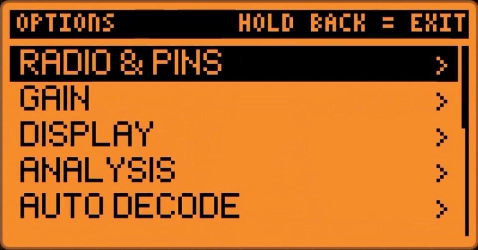

| Page | Items |
|---|---|
| **Radio & Pins** | Source, Preset, CC1101 CS, NRF24 CS, Pin Layout (wiring screen), Sweep Speed, Resolution, RX BW, RSSI Offset, 5V OTG |
| **Gain** | LNA gain, Mixer gain, IF target, Gain reset |
| **Display** | View, Wave Size, Scale, Trace style, Overlays, Grid, WF Palette, WF Rate, Cursor, Averaging, Peak Hold, Backlight |
| **Analysis** | Squelch, On Trigger, Alerts, Modulation, Scope Gap |
| **Auto Decode** | Auto Decode, Decode Notify, Decode Sens, Saved Decodes, Decoded counter |
| **Parallel Gather** | PG enable/disable, PG Mode, PG Combine, Int Offset, Ext Offset |
| **Multi Use** | Layout, Window 1-4 source, Ext Band, Int Band, NRF Band, NRF Scan speed, Wi-Fi Mode, Clear Packets, Focus Window |
| **System** | Memory (free / largest block), Stack free, Lite Mode, Intro (Full / Fast), Replay Intro |
| **Tools & Files** | Freeze, Reset Hold, Cursor > Peak, Marker B, Add Bookmark, Bookmarks, Log CSV, Snapshot, Capture .sub, Save Settings |
| **SDR Mode (GQRX)** | Starts the USB spectrum link for the PC bridge |
| **Help / About / Exit** | Key help and wiring pages, the illustrated About FlipSay guide, exit |

## Controls

| Key | Spectrum views | Other views |
|---|---|---|
| **OK** | Options menu | Options menu |
| **Hold OK** | Next band preset | Options menu |
| **Left / Right** | Scroll band (hold to speed up) | Meter/Scope: tune. Signals: Right = center on peak, Left = capture `.sub`. Channels: change page |
| **Up / Down** | Zoom in / out | Meter/Scope: tuning step. Signals: select |
| **Hold Up** | Freeze | Freeze |
| **Hold Down** | Reset hold/average | |
| **Back** | Next view (Multi Use: next window) | Same |

Multi Use wifi window: Left / Right = view, Up / Down = capture mode. SDR Mode: Back = leave.
| **Hold Back** | **Exit** | **Exit** |

## Files the app creates

| Path | Contents |
|---|---|
| `/ext/apps_data/flipsay/settings.bin` | Settings |
| `/ext/apps_data/flipsay/bookmarks.bin` | Bookmarks |
| `/ext/apps_data/flipsay/log_*.csv` | CSV sweep logs |
| `/ext/apps_data/flipsay/snap_*.bmp` | Screenshots |
| `/ext/apps_data/flipsay/events.csv` | Trigger events |
| `/ext/apps_data/flipsay/trace.log` | Startup and diagnostic trace |
| `/ext/subghz/FlipSay/*.sub` | Auto-decoded keys |
| `/ext/subghz/FlipSay_*.sub` | Raw captures |

## Build from source

```
pip install ufbt
ufbt update --index-url=https://up.momentum-fw.dev/firmware/directory.json --channel=dev
ufbt            # builds dist/flipsay.fap
ufbt launch     # builds and runs it on a connected Flipper
```

The code is in `src/`:

| File | Purpose |
|---|---|
| `flipsay.c` | Entry point, boot sequence with loading bar |
| `flipsay_radio.c` | Radio worker thread, sweeps, NRF24, Parallel Gather, Wi-Fi module, SDR Mode, Auto Decode |
| `flipsay_dsp.c` | Smoothing, peak hold, noise floor, peaks, waterfall data |
| `flipsay_ui.c` | All screens, menus, input handling, notification banner |
| `flipsay_gfx.c` | Tiny font, dithering, drawing helpers |
| `flipsay_about.c` | About guide pages, SDR Mode screen and school bus |
| `flipsay_sdr.c` | USB CDC link to the PC bridge (SDR Mode) |
| `flipsay_io.c` | Settings, bookmarks, screenshots, saved decodes |

The PC side of SDR Mode is `tools/flipsay_sdr_bridge.py` (Python 3, `numpy`, `pyserial`).

## Credits and license

- Decoding uses the Sub-GHz protocol library from the Flipper Zero firmware (Momentum).
- The NRF24 packet monitor follows the promiscuous-sniffing approach used by the Momentum NRF24 apps.
- Author: [itsc0c0](https://github.com/itsc0c0).

Licensed under the **GNU GPL v3.0**, see [LICENSE](LICENSE).

Use responsibly and only on signals and devices you are allowed to monitor. Parallel Gather runs two radios at once, so read the in-app warnings.
